<!-- Fichier généré par src/build.mjs. Modifier src/data.mjs puis lancer `npm run build`. -->

<b>English</b> &nbsp;·&nbsp; <a href="README.md">Français</a>

<a href="https://ahime.net">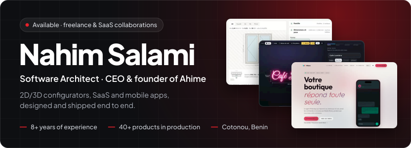</a>

Software architect and founder of <a href="https://ahime.net">Ahime</a>, a studio based in Cotonou. For more than eight years I have designed and shipped complete products, from the database to the app published on the store: 2D/3D configurators for made-to-measure manufacturers, point-of-sale and management software, WhatsApp agents and mobile apps, for West Africa and Europe.

    

## Featured projects

### Douke

**Prospecting agent for freelancers and small businesses**

<a href="https://entree.douke.ahime.net/demonstration">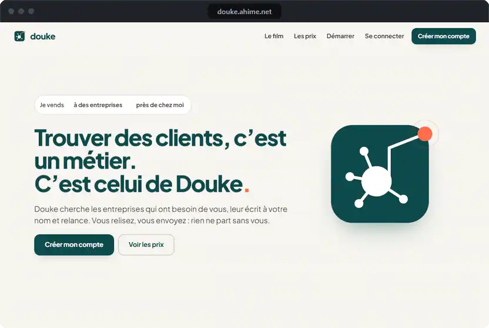</a>

Douke looks for the companies that need you, writes each one a message in your name and follows up. Nothing is sent without your approval: you review, edit or reject. It then prepares the meeting, the quote, the invoice and the review request, and shows the real figures of the week every Monday.

- A message written for each company, with the reason to contact it now: no website, hiring, recently opened
- Built-in limits: 20 messages a day at most, two follow-ups, then Douke stops
- Three plans (Solo, Local, Pro): a subscription and a capped share of the sales it brings; results of every account published, zeros included

`Python` `SQLite` `Cloudflare Workers` `D1` `Claude API`

 

 

### Wézon

**WhatsApp agent for shopkeepers, with Mobile Money payment**

<a href="https://wezon.ahime.net/">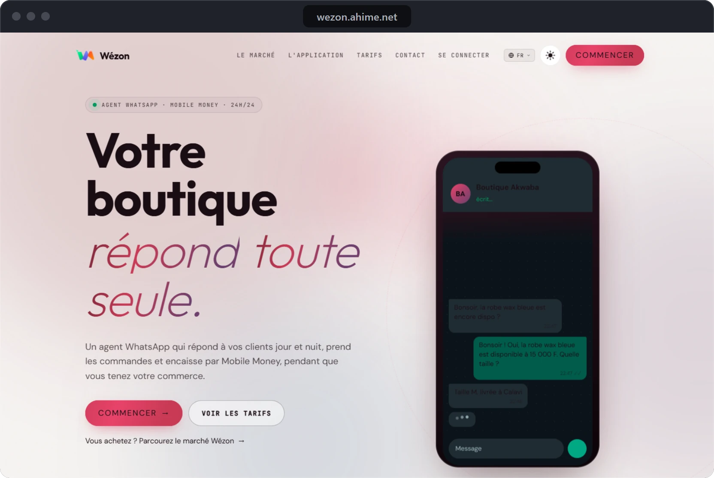</a>

A WhatsApp agent that answers customers day and night, takes orders and collects payment by Mobile Money. The shopkeeper follows messages, orders and takings from a web dashboard and an Android app.

- Catalogue, order and payment without leaving the WhatsApp conversation
- Two plans: a button menu, or an AI agent that hands over to the shopkeeper when a request is outside its role
- Public marketplace of shops, each with a page AI assistants can find

`TypeScript` `React` `Hono` `PostgreSQL` `Flutter` `KKiaPay`

 

### Mesura

**White-label 2D/3D configurator for made-to-measure manufacturers**

<a href="https://mesura.ahime.net/configurateur">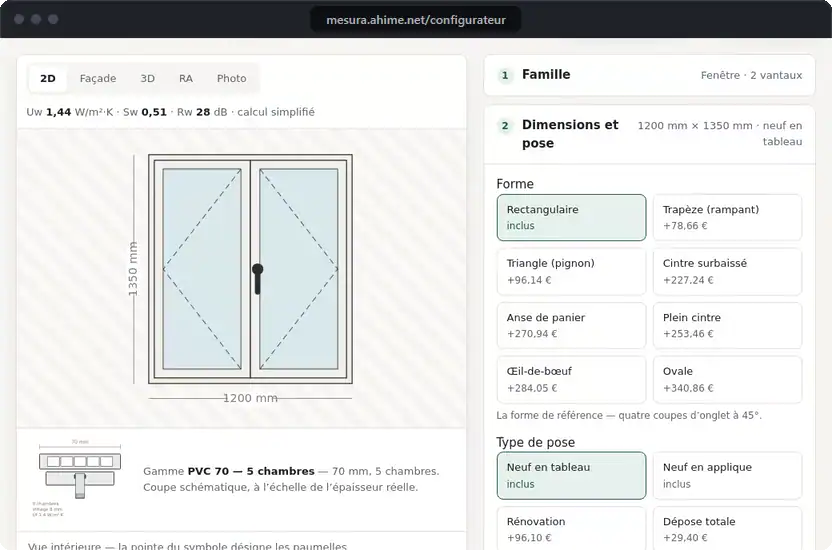</a>

Joiners, blind makers, fitters: their customers build the product themselves, see the dimensioned drawing and the 3D view, and the price is computed to the cent with the manufacturer's own rules. The approved quote becomes an order, a workshop sheet, then an invoice.

- 40 product families: windows, doors, shutters, gates, pergolas, furniture, solar
- One engine for the 2D drawing, the 3D geometry, the manufacturing rules and the price, recomputed server-side
- Embeddable web component, WooCommerce extension, pricing that also runs offline

`TypeScript` `React 18` `Three.js` `PHP` `WooCommerce`

 

 

### Neon Light Configurator

**WooCommerce extension to sell custom neon signs, without quotes**

<a href="https://neon-light.ahime.net/demo">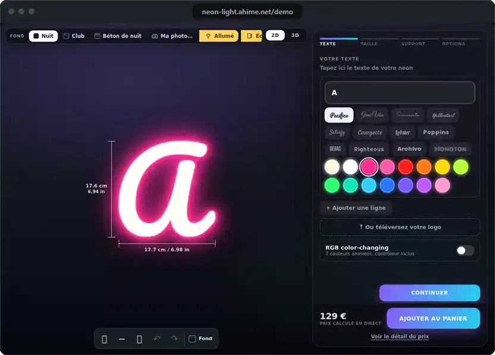</a>

The customer types their text, picks the font, colour and size, and watches the sign light up in 2D and 3D. The price follows the tube length actually measured along the letter outlines, then it is recomputed on the server before the item reaches the cart.

- Three products, three pricing engines: LED neon, cut panels, light boxes
- 12 interfaces, 5 complete themes and 33 pre-measured fonts
- Sign configurators delivered to seven shops in Belgium, Switzerland, the Netherlands and France

`PHP` `WordPress` `WooCommerce` `JavaScript` `Three.js`

 

 

### IMDF

**E-learning platform of the Institut des Métiers du Digital et du Freelancing**

<a href="https://imdf.co/">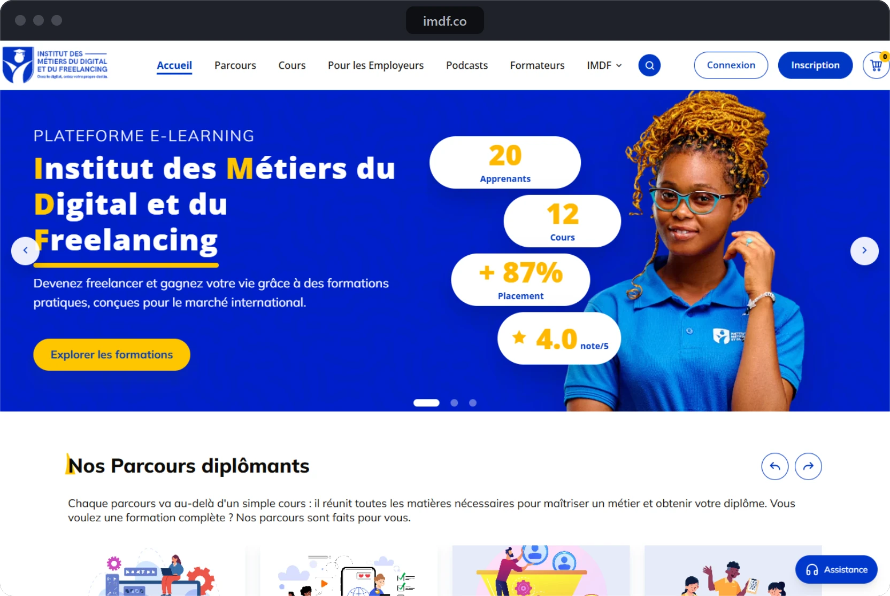</a>

The online training platform of IMDF, an institute for digital and freelance careers: degree paths and courses to learn a digital trade, then land the first freelance jobs. Learners, instructors, organisations and the institute's staff each have their own space.

- Courses in chapters with videos, documents and quizzes, grouped into paths, with a PDF certificate at the end
- Payment by FedaPay, KKiaPay, Stripe, PayPal or offline with proof; coupons and instructor commissions
- Fine-grained roles and permissions, blog, podcasts, forum, job offers and support tickets

`Laravel 11` `PHP` `MySQL` `Blade` `Tailwind CSS`

 

### Su POS

**Point of sale, stock and certified invoicing, even offline**

<a href="https://su.ahime.net/">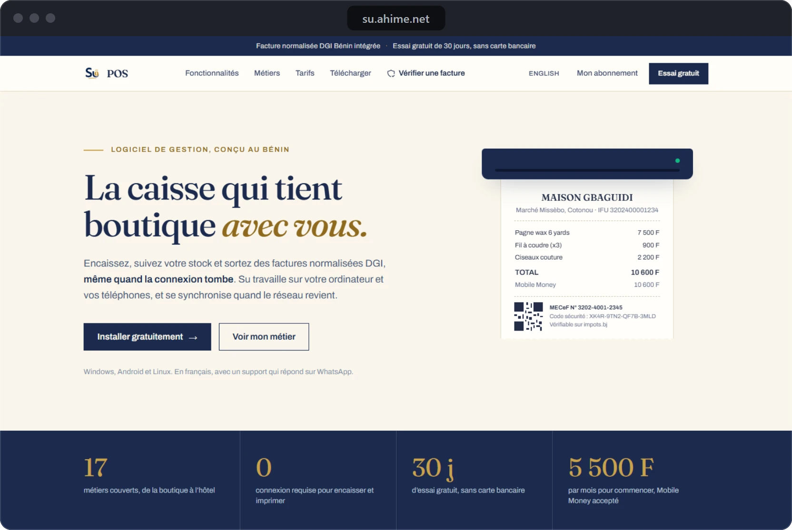</a>

Point-of-sale software designed in Benin: checkout, stock and certified e-MECeF invoices, even when the connection drops. A local server links the shop's terminals, and everything syncs with the cloud once the network is back.

- Offline-first: data encrypted on site, synced when the network returns
- 17 trades covered: shop, restaurant, salon, hotel, garage, school, wholesale
- Windows, Android and Linux, subscription paid by Mobile Money

`Flutter` `Dart` `Laravel` `PostgreSQL` `Redis`

## More work

A selection from more than forty products in production.

  <a href="https://lifac.ahime.net/"></a>
  <a href="http://tank-config.ziemann-holvrieka.com/"></a>
  <a href="https://wifitche.ahime.net/"></a>
  <a href="https://hin.ahime.net/"></a>
  <a href="https://imo.ahime.net/"></a>
  <a href="https://omniscan.ahime.net/"></a>

<b>Also:</b> <a href="https://github.com/nahim-salami/ajo-releases/releases">Ajo</a>, goal-based savings on Android · Figma AI Bridge, an MCP server and plugin to drive Figma from an AI assistant (open source, MIT) · online shops and configurators for clients in Belgium, Switzerland, the Netherlands, the United Kingdom and Canada.

## Stack

  

## Contact

A product to design, a configurator to integrate, an app to ship? I reply within 24 hours, in French or English.

    

README generated by <code>src/build.mjs</code> · screenshots and demos taken from the live products.

