<!-- Fichier généré par src/build.mjs. Modifier src/data.mjs puis lancer `npm run build`. -->

<b>Français</b> &nbsp;·&nbsp; <a href="README.en.md">English</a>

<a href="https://ahime.net">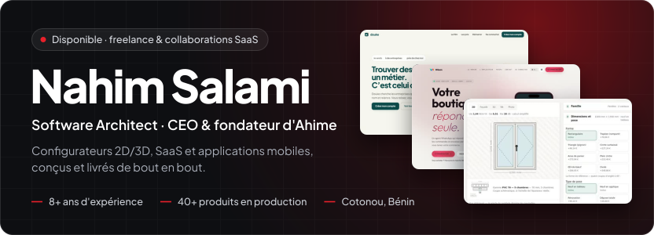</a>

Architecte logiciel et fondateur d'<a href="https://ahime.net">Ahime</a>, studio basé à Cotonou. Depuis plus de huit ans, je conçois et je livre des produits complets, de la base de données à l'application publiée sur le store : configurateurs 2D/3D pour les fabricants sur mesure, logiciels de caisse et de gestion, agents WhatsApp et applications mobiles, pour l'Afrique de l'Ouest et l'Europe.

    

## Projets phares

### Mesura

**Configurateur 2D/3D en marque blanche pour les fabricants sur mesure**

<a href="https://mesura.ahime.net/configurateur">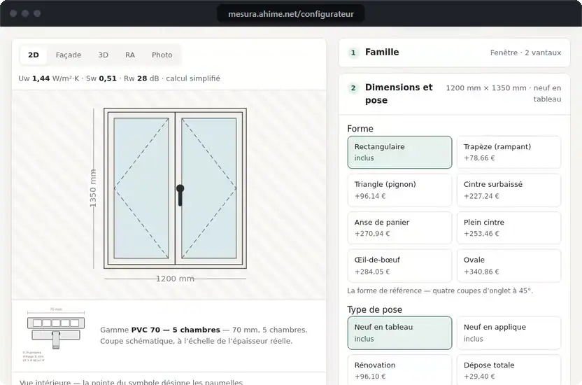</a>

Menuisiers, storistes, agenceurs : leurs clients composent le produit eux-mêmes, voient le dessin coté et la vue 3D, et le prix est calculé au centime avec les règles du fabricant. Le devis approuvé devient commande, fiche d'atelier, puis facture.

- 40 familles de produits : fenêtres, portes, volets, portails, pergolas, meubles, photovoltaïque
- Un seul moteur pour le dessin 2D, la géométrie 3D, les règles de fabrication et le prix, recalculé côté serveur
- Web component embarquable, extension WooCommerce, calcul possible hors ligne

`TypeScript` `React 18` `Three.js` `PHP` `WooCommerce`

 

 

### Neon Light Configurator

**Extension WooCommerce pour vendre des enseignes néon sur mesure, sans devis**

<a href="https://neon-light.ahime.net/demo">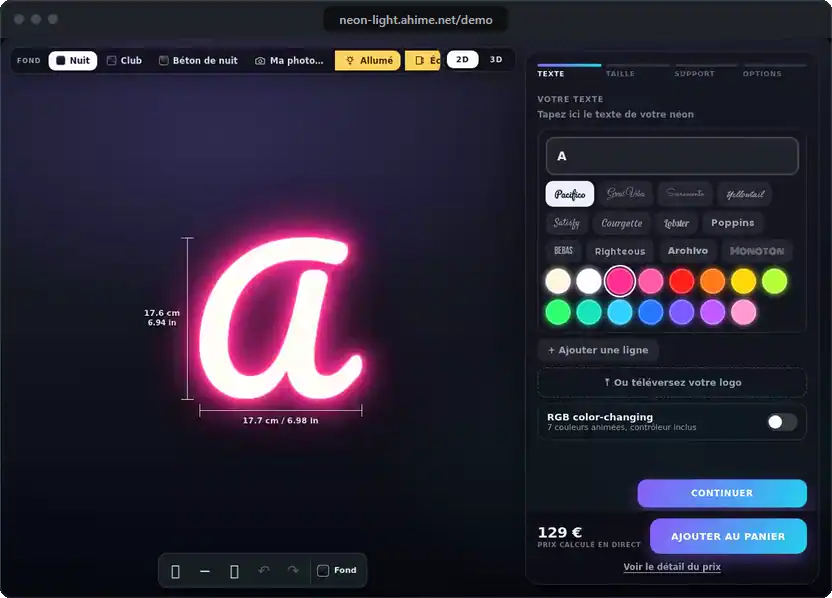</a>

Le client écrit son texte, choisit la police, la couleur et la taille, et voit son enseigne s'allumer en 2D et en 3D. Le prix suit la longueur de tube réellement mesurée sur le tracé des lettres, puis il est recalculé sur le serveur avant l'ajout au panier.

- Trois produits, trois moteurs de calcul : néons LED, panneaux découpés, caissons lumineux
- 12 interfaces, 5 thèmes complets et 33 polices pré-mesurées
- Configurateurs d'enseignes livrés à sept boutiques en Belgique, en Suisse, aux Pays-Bas et en France

`PHP` `WordPress` `WooCommerce` `JavaScript` `Three.js`

 

 

### Wézon

**Agent WhatsApp pour les commerçants, avec paiement Mobile Money**

<a href="https://wezon.ahime.net/">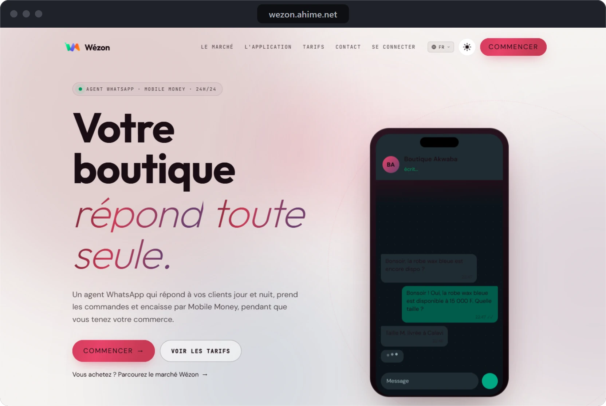</a>

Un agent WhatsApp qui répond aux clients jour et nuit, prend les commandes et encaisse par Mobile Money. Le commerçant suit ses messages, ses commandes et ses encaissements depuis un tableau de bord web et une application Android.

- Catalogue, commande et paiement sans quitter la conversation WhatsApp
- Deux offres : menu à boutons, ou agent IA qui passe la main au commerçant dès qu'une demande sort de son rôle
- Marché public des boutiques, avec une fiche trouvable par les assistants IA

`TypeScript` `React` `Hono` `PostgreSQL` `Flutter` `KKiaPay`

 

### Su POS

**Caisse, stock et facturation normalisée, même hors connexion**

<a href="https://su.ahime.net/">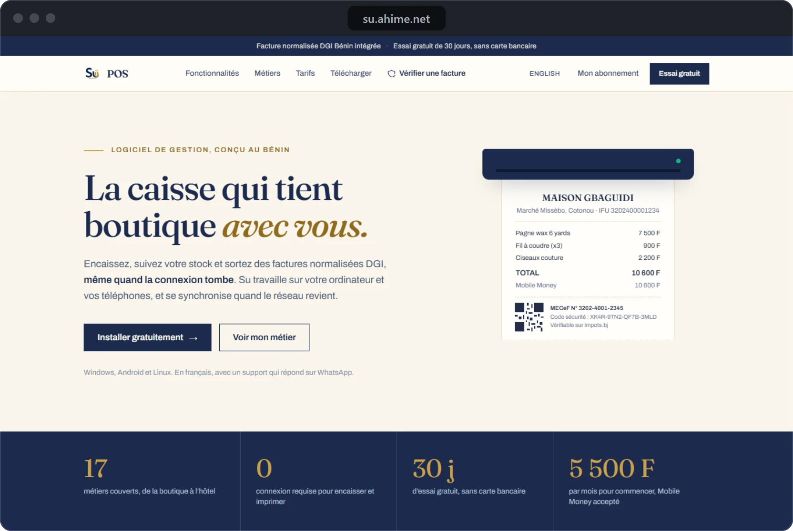</a>

Logiciel de caisse conçu au Bénin : encaissement, stock et factures normalisées e-MECeF, même quand la connexion tombe. Un serveur local relie les postes de la boutique, et tout se synchronise avec le cloud dès que le réseau revient.

- Offline-first : données chiffrées sur place, synchronisation dès le retour du réseau
- 17 métiers couverts : boutique, restaurant, salon, hôtel, garage, école, distribution
- Windows, Android et Linux, abonnement payé par Mobile Money

`Flutter` `Dart` `Laravel` `PostgreSQL` `Redis`

 

### Hin

**Espace de travail pour les équipes : tâches, CRM, documents**

<a href="https://hin.ahime.net/">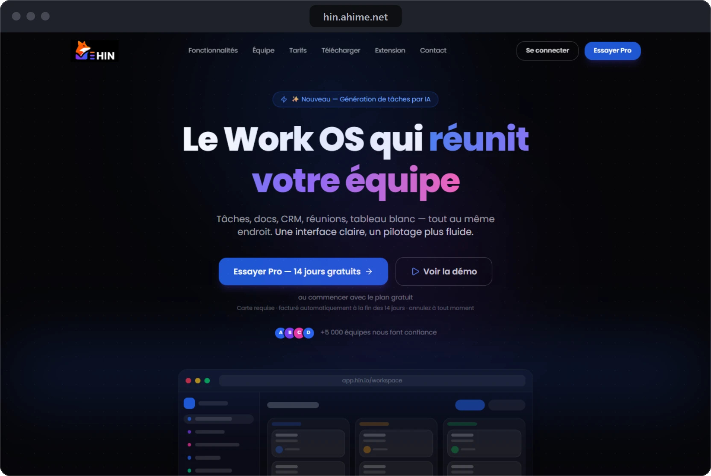</a>

Tâches, documents, CRM, réunions et tableau blanc au même endroit, avec génération de tâches par IA. Une alternative abordable à Asana, ClickUp et Trello, disponible sur le web, macOS, Windows, Linux, iOS, Android et en extension Chrome.

- 8 vues : liste, board, calendrier, Gantt, timeline, charge, Eisenhower, tableau
- Tableaux de bord : burndown, vélocité, charge de l'équipe
- Sécurité : double authentification, journal d'audit, 13 rôles

`React` `Tauri` `Capacitor` `Laravel` `Gemini`

 

### Douke

**Agent de prospection pour les indépendants et les petites entreprises**

<a href="https://entree.douke.ahime.net/demonstration">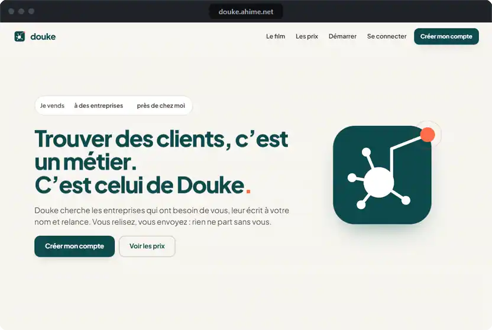</a>

Douke cherche les entreprises qui ont besoin de vous, écrit à chacune un message à votre nom et relance. Rien ne part sans votre accord : vous relisez, vous modifiez ou vous refusez. Il prépare ensuite le rendez-vous, le devis, la facture et la demande d'avis, et montre chaque lundi les vrais chiffres de la semaine.

- Un message écrit pour chaque entreprise, avec la raison de lui écrire maintenant : site absent, recrutement, ouverture récente
- Garde-fous intégrés : 20 messages par jour au plus, deux relances, puis Douke s'arrête
- Trois formules (Solo, Local, Pro) : un abonnement et une part plafonnée sur les ventes apportées ; résultats de tous les comptes publiés, zéros compris

`Python` `SQLite` `Cloudflare Workers` `D1` `Claude API`

 

## Autres réalisations

Une sélection parmi plus de quarante produits en production.

  <a href="https://wifitche.ahime.net/"></a>
  <a href="https://imo.ahime.net/"></a>
  <a href="http://tank-config.ziemann-holvrieka.com/"></a>
  <a href="https://omniscan.ahime.net/"></a>
  <a href="https://lifac.ahime.net/"></a>
  <a href="https://imdf.co/"></a>

<b>Et aussi :</b> <a href="https://github.com/nahim-salami/ajo-releases/releases">Ajo</a>, épargne par objectifs sur Android · Figma AI Bridge, serveur MCP et plugin pour piloter Figma depuis un assistant IA (open source, MIT) · boutiques en ligne et configurateurs pour des clients en Belgique, en Suisse, aux Pays-Bas, au Royaume-Uni et au Canada.

## Stack

  

## Contact

Un produit à concevoir, un configurateur à intégrer, une application à livrer ? Je réponds sous 24 h, en français ou en anglais.

    

README généré par <code>src/build.mjs</code> · captures et démos issues des produits en ligne.

